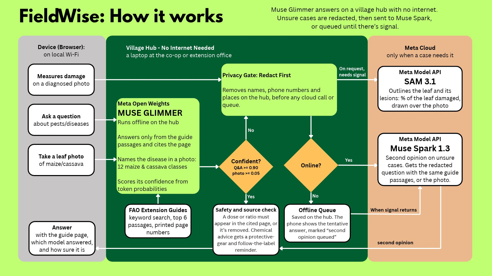
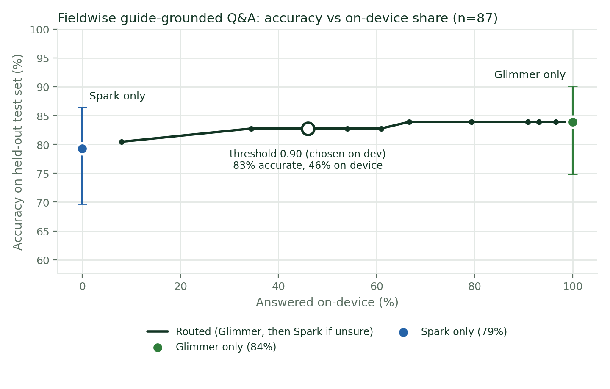
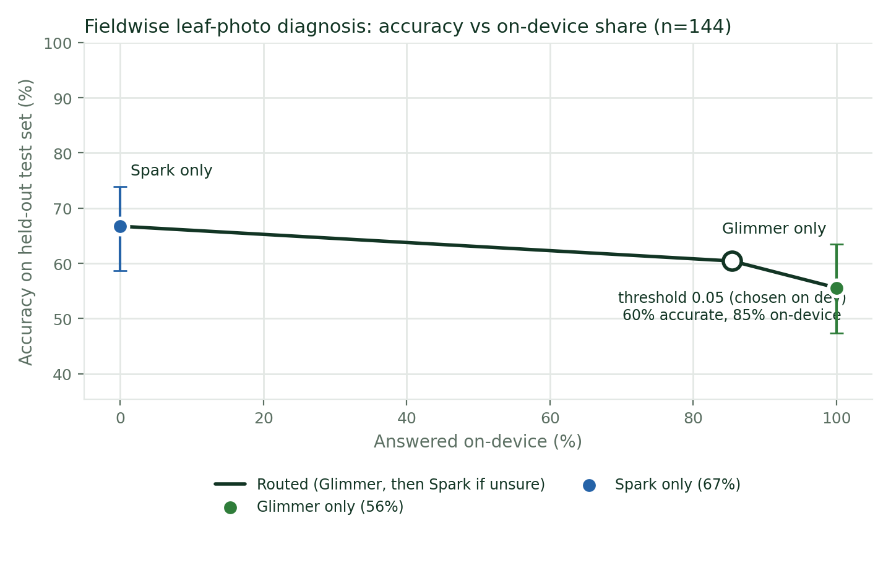

# Fieldwise

**Crop-protection advice that works without signal.** An offline-first assistant for smallholder farmers and the extension workers who support them, built on Meta's Muse Glimmer, Muse Spark and SAM 3.1.

A farmer asks a question or photographs a leaf from any phone with a browser. The phone connects over local Wi-Fi to a **village hub**, one shared machine at the co-op or extension office, where **Muse Glimmer** answers from FAO extension guides with no internet, citing the guide page and showing how confident it is. Only when Glimmer is unsure does the hub remove personal details and send the case to **Muse Spark** in the cloud; with no signal, it waits in a queue. **SAM 3.1** outlines the leaf in a photo so the damaged tissue can be marked.

On 87 held-out questions, routing answered **46% on the hub** and scored **82.8%**, against 83.9% for Glimmer alone and 79.3% for Spark alone, at **about half the cloud cost** per question.

## The problem

Smallholder farmers often find a pest or disease when no extension officer is nearby, and mobile signal on farms comes and goes. A cloud-only assistant needs a good connection for every question, sends the farmer's words and photos (with names, phone numbers and GPS tags) off the phone, and a general-purpose model can state pesticide doses with no source.

Fieldwise is designed the other way round:
- **The hub answers first, offline.** Phones need only a browser and the hub's Wi-Fi, so no mobile data.
- **The cloud is a second opinion, not a dependency.** Only low-confidence cases go to Spark, and only after redaction. Offline, they're queued and the farmer gets the hub's answer marked as tentative.
- **Advice comes from the guides, with the page cited.** Doses must appear in a cited passage, chemical advice always carries a safety reminder, and anything the guides don't cover becomes a referral to the local extension officer.

## How it works



| Model | Runs | Job |
|---|---|---|
| **Muse Glimmer 30B** (open weights, Meta's Q4_K_M GGUF via llama.cpp) | Village hub, offline | First answer to every question and photo. Confidence comes from its own token probabilities. |
| **Muse Spark** (`muse-spark-1.3`, Meta Model API, Standard mode) | Cloud | Second opinion when Glimmer's confidence is below the threshold. Receives redacted text and a GPS-free photo, plus the same guide passages. |
| **SAM 3.1** (`sam-3.1`, Meta Model API) | Cloud, on request | Outlines the leaf in a photo; the hub then marks the parts that aren't healthy green. |

**Why a hub and not the phone:** Glimmer is a dense 30B model (Meta's Q4 build is about 17 GB plus a 1.4 GB vision projector). No low-end phone can hold it, but one machine with about 24 GB of memory can serve a whole village's phones.

**How an answer is made**
1. **Photos lose their EXIF data on arrival**, including the GPS position phones embed (`fieldwise/imageprep.py`).
2. **Retrieve:** BM25 finds the six best guide passages and measures how much of the question they cover (`fieldwise/retrieval.py`).
3. **Glimmer answers** in a fixed format ending `SUPPORTED: YES/NO` (questions) or `ANSWER: <letter>` (photos: the crop's classes plus "unsure").
4. **Confidence:** the probability Glimmer gave its own final token, from llama.cpp logprobs; for questions it's scaled by retrieval coverage (`fieldwise/confidence.py`, `fieldwise/router.py`).
5. **Route:** at or above the threshold, the hub's answer stands. Below it, the hub redacts (`fieldwise/redact.py`) and asks Spark if online, or queues the case and shows Glimmer's answer as tentative if offline (`fieldwise/queue.py`).
6. **Safety check on every text answer**, local or cloud (`fieldwise/safety.py`):
   - any dose, ratio or interval must appear in a cited passage, or that sentence is removed;
   - any pesticide mention adds a fixed reminder to wear protective equipment and follow the label;
   - an answer the guides don't support becomes a referral to the extension officer.
Thresholds were chosen on the dev split: **0.90 for questions, 0.05 for photos**.

## Results

All numbers are on held-out **test** splits; thresholds, retrieval settings and prompt phrases were chosen on dev data only. Accuracy has 95% Wilson intervals. Glimmer ran on a Kaggle notebook with 2× NVIDIA T4 (Meta's official Q4_K_M GGUF, same launcher and settings as the hub); Spark ran through the Meta Model API. Cost counts Meta API spend only, at Standard-mode prices.

### Questions (87 test questions, 75 answerable from the guides, 12 out of scope)

| Setup | Accuracy (95% CI) | Answered on the hub | Latency median / p90 | API cost per question |
|---|---|---|---|---|
| Glimmer only | 83.9% (75–90) | 100% | 21.6 / 31.6 s (Kaggle T4) | $0 |
| Spark only | 79.3% (70–86) | 0% | 5.4 / 8.5 s | $0.0070 |
| **Routed (threshold 0.90)** | **82.8% (73–89)** | **46%** | 23.5 / 35.0 s | **$0.0036** |

- **Retrieval is the ceiling.** All key facts were in the six passages for 85% of answerable test questions (64/75). When they were, Glimmer scored 95% (61/64), Spark 89% (57/64) and routing 94%. When they weren't, every setup scored 0/11.
- **Out-of-scope questions** (other crops, prices, doses the guides don't give) were declined with a referral by every setup: 12/12.
- **Spark's content filter refused 9 of the 87 test questions**, ordinary farming questions such as whether fall armyworm only attacks maize. Refusals are scored as no answer. On the 78 it answered, Spark scored 85% (66/78), about level with Glimmer; the gap between them comes from the filter.
- The confidence intervals overlap: Glimmer and Spark are statistically comparable on questions.
- Confidence quality: AUROC 0.63, ECE 0.160. The safety check removed an unsupported quantity once from each model.

### Leaf photos (144 test photos, 12 maize and cassava classes, CCMT field photos from Ghana)

| Setup | Accuracy (95% CI) | Answered on the hub | Latency median / p90 | API cost per photo |
|---|---|---|---|---|
| Glimmer only | 55.6% (47–63) | 100% | 12.6 / 16.3 s (Kaggle T4) | $0 |
| Spark only | 66.7% (59–74) | 0% | 4.3 / 9.6 s | $0.0041 |
| **Routed (threshold 0.05)** | **60.4% (52–68)** | **85%** | in `summary_images.md` | **$0.0007** |
- Spark is clearly stronger on photos. The threshold chosen on dev under-escalated on test (routed is 6 points below Spark); it's reported as is, not re-tuned on test.
- Confidence quality: AUROC 0.76, ECE 0.299 (Glimmer's photo confidence is over-confident).

The accuracy / on-hub trade-off at every threshold is in `bench/results/tradeoff_qa.png`, `tradeoff_images.png` and the `summary_*.md` files.




### Privacy: redaction on the hub

| Test messages | Details | Removed | Removed by mistake |
|---|---|---|---|
| 35 written by the rule author | 40 | 90% (36/40); phones, emails, IDs, GPS, addresses 100%; names 14/15; places 7/10 | 0 |
| 20 new messages written by the developer after the last rule change | 60 | **95% (57/60)**; names 17/20, places 20/20, phones 20/20 | 0 |

An earlier set of 20 developer-written messages exposed that **lowercase names were never caught (0/20)**: "my name is kofi", "ama here". The name rules were fixed using that set, so it no longer counts as a test (it now scores 100%). Remaining misses: a name with no introduction ("Abena told me…"), messages opening "*name* in *Place*", lowercase place names, and places at the start of a sentence. No set has yet been written by someone independent.

### Damage measurement: SAM 3.1

Validated against PlantSeg's hand-drawn lesion masks for corn gray leaf spot.
- **SAM 3.1 phrase prompts don't outline these lesions.** Eight phrases tried on validation photos (best: "brown patch", mean IoU 0.10). On 15 test photos, "brown patch" scored mean IoU 0.19 and found nothing on 6 of 15.
- **"leaf" works well:** SAM 3.1 found the leaf on 6/6 CCMT dev photos and 14/15 PlantSeg test photos.
- **Hybrid: SAM 3.1 outlines the leaf, colour marks the damage inside it.** Colour cut-offs were tuned on validation photos. On the 15 test photos: lesion IoU 0.35, but the **share of the leaf damaged was off by 23.1 points at the median** (p90 54.9) and over-estimated on 10 of 14.
- That missed the bar set before testing (median error ≤ 15 points), so **the app shows no percentage**: it shows SAM's leaf outline with off-colour areas marked as "areas to check". Not validated: yellow symptoms (streak, mosaic), cassava, insect damage. Insect damage isn't measured at all.

### Hardware

Glimmer needs about 24 GB of memory. On the development laptop (16 GB RAM, 4 GB laptop GPU), community 3-bit builds read photo prompts at 0.5–1.4 tokens per second, and a 2-bit text-only build wrote about 0.1 tokens per second. None could answer within the app's 10-minute timeout, so Glimmer doesn't run live there. The benchmark and live demo use a Kaggle GPU instead; a real hub would be a shared 32 GB machine, for example an Apple-silicon laptop, or a PC with a 24 GB GPU.

### Failure cases found along the way

- **Spark's content filter** refused ordinary farming questions (9 of 87 test questions). The API key was temporarily restricted after about a dozen refusals during the benchmark run (the likely cause), so the runner now stops after 3 refusals and the app pauses Spark after 2.
- **SAM 3.1's live replies arrive only in the final stream event.** The first SAM run read nothing back (0 matches on 15/15) until the reader was rewritten to Meta's protocol; that run was discarded.
- **Re-tuning that missed the bar:** tuning the damage colour cut-offs for overlap made the percentage worse (median error 35.7 points); tuning for the percentage itself improved it to 23.1, still not good enough to show.

## Run it

```bash
pip install -r requirements.txt
cp .env.example .env  # Windows: copy .env.example .env
# MODEL_API_KEY   = your Meta Model API key
# GLIMMER_API_KEY = any password you make up, shared by the app and the local llama.cpp server
# FAO guide text with printed page numbers (not in the repo: FAO's terms are non-commercial).
# Extract the text of each guide yourself, then:
python scripts/paginate_text.py raw.txt data/guides/fao_cassava_ffs_2013.txt --header "Cassava farmer field schools"
cp data/guides/sources.example.json data/guides/sources.json
python scripts/ingest_guides.py

# Muse Glimmer with llama.cpp (needs ~24 GB of memory)
python scripts/start_glimmer.py # downloads Meta's official Q4 GGUF if GLIMMER_GGUF isn't set
python scripts/check_setup.py # checks .env, model files, llama.cpp + GPU, Glimmer and the guide index

# The hub; phones on the same Wi-Fi open http://<hub-ip>:8000
uvicorn app.server:app --host 0.0.0.0 --port 8000

python -m pytest -q # 111 tests, no network needed
```

The phone UI is one HTML file with fonts served by the hub; it loads nothing from the internet. It has light and inverse (dark) modes and works on phones and laptops.

<details>
<summary><b>No 24 GB machine? Run the hub on a free Kaggle GPU</b></summary>

1. `python bench/pack_for_kaggle.py` makes `fieldwise_kaggle.zip` (code, app, reviewed questions, frozen photo manifest and the 204 photos, guide text; never `.env`). Upload it as a **private** Kaggle dataset.
2. Import `kaggle/fieldwise_glimmer_kaggle.ipynb`, set Accelerator = GPU (T4 x2) and Internet = On, add the dataset, and run **setup** and **serve**.
3. Then one of:
   - `ui`: the real app with live Glimmer at a temporary Cloudflare link, Meta API off (low-confidence cases are queued);
   - `ui --spark`: the same with live Spark and SAM 3.1, using a `MODEL_API_KEY` stored in Kaggle's Add-ons > Secrets;
   - `demo [IDs]`: sends demo questions and photos through the app pipeline and prints what the app would show, with real times;
   - `bench qa` / `bench images`, then `pack`: the Glimmer half of the benchmark.

Anyone with the tunnel link can use the app while it's up; run the `stop` cell when done.
</details>

<details>
<summary><b>Demo safety nets</b></summary>

- `FIELDWISE_FORCE_OFFLINE=1`, or the Online/Offline button in the app: behave as if there's no signal.
- `FIELDWISE_CACHE_ONLY=1`: every Spark and SAM reply is cached under `data/cache/`; replay those and never call the network.
- `FIELDWISE_GLIMMER_REPLAY=1`: for a hub too small to run Glimmer, show Glimmer's real recorded benchmark outputs for benchmark questions and photos. Every replayed answer is labelled "Demo replay" in the app, other questions get no Glimmer answer, and the benchmark refuses to run in this mode. `python bench/demo_examples.py` picks examples for each demo scene.
- Account guard: the app pauses Spark after 2 content-filter refusals and stops all Meta calls if the key is refused.
</details>

<details>
<summary><b>Reproduce the benchmark</b></summary>

```bash
# Datasets go in datasets folder: CCMT in datasets/CCMT, PlantSeg in datasets/PlantSeg
python bench/prepare_images.py --dev-per-class 5 --test-per-class 12 # frozen 60 dev / 144 test split

# Questions: review in a spreadsheet, then write back (the runner refuses unreviewed questions)
python bench/review_questions.py export
python bench/review_questions.py import
python bench/retrieval_eval.py # dev only while tuning; --split test once, after freezing

# Each setup on every item (resumable; errored items are retried, refusals are scored)
python bench/run_bench.py --task qa --setup cloud
python bench/run_bench.py --task images --setup cloud
python bench/run_bench.py --task qa --setup local # or on Kaggle: bench qa / bench images
python bench/analyze.py --task qa # threshold on dev, report on test, chart
python bench/analyze.py --task images

python bench/peek.py qa_cloud --wrong # what each model answered on wrong items
python bench/manual_grade.py export # optional blind manual check of auto grades
python bench/redaction_eval.py # or --cases bench/data/<your set>.txt
python bench/sam_phrases.py --yes # SAM phrase selection on PlantSeg val
python bench/lesion_tune.py --yes # colour cut-offs on PlantSeg val
python bench/sam_eval.py --method colour --plants corn maize --diseases "leaf spot" --n 15
```

Integrity rules built into the harness:
- Thresholds, retrieval settings, SAM phrases and colour cut-offs are chosen on dev or validation data and reported once on test.
- The routed setup is replayed per item from independent Glimmer and Spark runs, so the full threshold sweep costs nothing extra.
- The runner refuses the stub model, unreviewed questions and replay mode.
- Every Q&A record stores whether retrieval found the key facts, so retrieval misses aren't blamed on the model.
- `bench/results/environment_*.json` records model IDs, settings and the device for each run; every record has a UTC timestamp.
</details>

## Repository layout

```
app/          hub server (FastAPI) and the phone UI (one HTML file + Poppins fonts)
fieldwise/    pipeline: redact, retrieval, confidence, router, safety, queue, lesions, replay
  providers/  Muse Glimmer (llama.cpp), Muse Spark and SAM 3.1 (Meta Model API) clients
scripts/      setup: start Glimmer, download quants, ingest guides, check the setup
bench/        benchmark: prepare, run, analyze, grading, redaction and SAM evaluations, demo helpers
kaggle/       notebook and script for the Kaggle GPU (benchmark, live app, live demo)
tests/        111 tests, no network needed
datasets/     CCMT and PlantSeg datasets (not committed)
```

## Data and licences

Scope: **maize and cassava** (12 photo classes), the crops with FAO guides that have clear reuse terms. Tomato is defined but switched off until a licensed guide covers its classes.

| Source | Used for | Licence / terms |
|---|---|---|
| CCMT: Mensah et al., *Data in Brief* 2023, doi:10.17632/bwh3zbpkpv.1; field photos from farms in Ghana | Photo benchmark (raw images only) | CC BY 4.0 |
| FAO (2018), *Integrated management of the Fall Armyworm on maize: a guide for Farmer Field Schools in Africa* | Answers for maize | FAO copyright: research, teaching and non-commercial use with acknowledgement |
| FAO (2013), *Cassava Farmer Field Schools: resource material for facilitators in sub-Saharan Africa* (Plant Production and Protection Paper 218) | Answers for cassava | FAO copyright: study, research and teaching use; passages quoted verbatim with citations |
| PlantSeg: Wei et al. 2024 | SAM 3.1 validation | CC BY-NC-ND 4.0: numbers only; no images or masks are redistributed or shown |
| Multilingual agricultural QA (Mendeley, CC BY 4.0) and AgMMU (CC BY-SA 4.0) | Realistic farmer wording for the question set; answers come from the FAO guides only | As stated |
| Muse Glimmer 30B (Meta) | The hub model | Apache 2.0 |
| Poppins (Indian Type Foundry) | UI font, served by the hub | SIL Open Font License 1.1 (`app/static/fonts/OFL.txt`) |

Datasets, guide text and model weights are not included in this repository.

## Limitations

- **Hardware:** a hub needs about 24 GB of memory; on smaller machines Glimmer can't answer in reasonable time.
- **Retrieval caps answer quality** at about 85% of test questions; when BM25 misses the passage, the honest answer is a referral.
- **Photo diagnosis is weaker than Spark's** (55.6% vs 66.7%) and Glimmer's photo confidence is over-confident (ECE 0.299).
- **Redaction is rule-based:** it misses names with no introduction, some message openings, lowercase places and places that start a sentence. No independent person has tested it yet.
- **The quantity check is about provenance:** it checks that each number came from a cited passage, not that it's attached to the right product.
- **The damage view is a visual aid, not a measurement.** The percentage failed validation and isn't shown.
- **Spark's content filter** refuses some ordinary farming questions; the farmer then gets a referral to the extension officer.
- **Latency figures are from Kaggle T4 GPUs**, not from a hub machine.
- **The question set was drafted by an AI assistant** (Claude, by Anthropic) from the guide text and reviewed by the developer; questions written this way may be easier than real farmer questions.

## Acknowledgements and disclosures

- FAO for the extension guides; Mensah et al. for CCMT; Wei et al. for PlantSeg; Meta for Muse Glimmer, Muse Spark and SAM 3.1; the llama.cpp project; the Poppins authors.
- Built for the Meta × Cerebral Valley Global AI Developer Hackathon 2026. Developed with Claude as a coding assistant, which also drafted the benchmark question set.